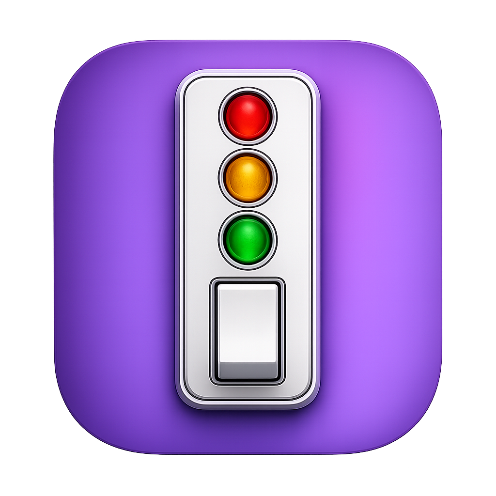

  

# streampec

> macOS menubar utility: Elgato Stream Deck XL as a PEC/DIR work surface for Pro Tools (PTSL).

## What it does

streampec turns a Stream Deck XL into a tactile control surface for Pro Tools, with one row of 8 buttons each for **SOLO**, **MUTE**, **REC**, and **INPUT** across up to 8 tracks. State mirrors from Pro Tools via PTSL change-events; key presses issue setter RPCs. No optimistic updates - what the deck shows is what PT says.

## Install

1. Download the latest [DMG](../../releases).
2. Drag streampec into `/Applications`.
3. On first launch, accept the End User License Agreement.

Requires macOS 11+, Pro Tools with PTSL enabled (`Preferences -> Synchronization -> Enable PTSL`), and an Elgato Stream Deck XL.

## Configuration

streampec stores preferences as JSON in `~/Library/Application Support/streampec/config.json`:

| Field | Default | Description |
| --- | --- | --- |
| `pt_addr` | `localhost:31416` | Pro Tools PTSL gRPC address |
| `brightness` | `75` | Stream Deck brightness 0-100 |
| `folder` | `print` | PT folder name whose child audio tracks fill the surface; empty = all audio tracks |

Edit the file directly while streampec is closed, or use the menubar Settings submenu for brightness and folder filter.

## Privacy

Local only. streampec talks to:

- Pro Tools at the configured PTSL address (default `localhost:31416`)
- Your USB-attached Stream Deck XL
- `buymeacoffee.com/bootlegcheeseburger` only when you click the donate menubar item

No analytics, no auto-update, no telemetry. Full text in the EULA (`EULA.txt` in the DMG, also shown on first launch).

## Support

If streampec earned its keep, you can [buy me a cheeseburger](https://www.buymeacoffee.com/bootlegcheeseburger) 🍔.

## Bug reports + feature requests

Open an [issue](../../issues). Source is closed; this repo accepts user-facing bug reports and feature requests only. See [SECURITY.md](SECURITY.md) for vulnerability disclosure.

## License

streampec is proprietary software. Use of the app is governed by the EULA shown on first launch (`EULA.txt` in each release DMG). © 2026 Bootleg Cheeseburger, LLC. All rights reserved.
